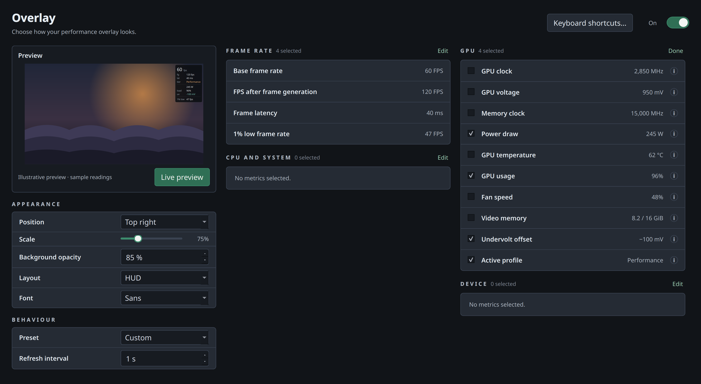

# Performance Overlay

> Feature guide — see the [README](../../README.md) for the project overview.

The overlay shows live FPS, latency, GPU telemetry, and the active profile
while you play.



## Enabling the overlay

In [Game Library](game-library.md), enable **Wrap this game** and **Overlay**.
Use the Overlay tab to choose fields and appearance. For manual launch options,
see [Steam](../steam.md#manual-launch-options), [Lutris](lutris.md),
[Heroic](heroic.md) or [Faugus](faugus.md).

The controls are grouped by the question they answer — **Placement and size**,
**Style**, **Behaviour** — with the preview beside them and the field list
below.

- **Enable overlay** — master toggle.
- **Refresh** — how often the readout refreshes (e.g. `1 s`).
- **Size** — size multiplier (`0.5x`, `0.75x`, `1x`, `1.5x`, `2x`). `1x`, the
  default, draws text about as large as MangoHud's default at 1440p; the
  overlay already grows and shrinks with the game's resolution on its own.
  The fractional steps need **Sans** or **Mono**; the **Pixel (bitmap)** face
  can only be magnified by whole pixels, so it rounds to the nearest whole
  size.
- **Detail** — how much the overlay shows: **Minimal** (frame rate only),
  **Standard** (frame rate, FG, latency, tier), **Detailed** (adds clocks,
  voltage, power, 1% low, GPU/CPU load and temperature), **Everything** (all
  fields),
  or **Custom**. Ticking or unticking any field below switches to Custom and
  keeps your own selection.
- **Opacity** — how much of the game shows through the overlay's panel. Only
  the blended renderer can honour it; the text itself stays fully opaque.
- **Layout** — **HUD** is the designed arrangement: the frame rate as a
  headline, dim labels beside their values, rules between groups and a quieter
  footer for the device line. **Table** is the plain grid every field shares,
  which is what shipped first. Both renderers draw either one.
- **Font** — which face the readout is drawn in. **Sans** (the default) and
  **Mono** are real typefaces drawn from a signed-distance atlas, so they stay
  sharp at any overlay scale instead of turning into magnified pixels;
  **Pixel (bitmap)** is the original 5x8 face. Sans and Mono need the blended
  renderer, and the overlay falls back to Pixel on its own when there is no
  pipeline.
  Sans is the default because it is the face that survives the smallest sizes,
  and it is set in a medium weight: measured against MangoHud on the same
  frame, a regular weight left only a few per cent of its inked pixels fully
  opaque, because at body size a regular stem is about two pixels and splitting
  one across a pixel boundary leaves no solid core — the text reads as a grey
  haze however large it is. The type is also drawn with a one-pixel dark halo,
  so it keeps its contrast where the translucent panel lets a bright scene
  through.
  Fixed-pitch faces draw a slashed or dotted zero, and that mark is the first
  thing to close up once the caps are only a few pixels tall — which is what
  turned `2820` into something unreadable at the smallest overlay scale. Sans
  carries tabular figures, so its digits still hold a fixed column and a
  counter that changes does not shuffle the row, and it sets about a sixth
  narrower for the same cap height.
  With a proportional face the columns are placed from measured widths rather
  than padded with spaces, because every character has its own.
- **Renderer** — **Blended** draws through a Vulkan pipeline, which is what
  makes translucency and rounded corners possible. **Solid (compatibility)**
  forces the original renderer, which draws with cleared rectangles and cannot
  blend. Blended falls back to Solid on its own when a driver will not give it
  a pipeline, so the HUD never disappears over it.
- **Position** — which corner the readout sits in: top left,
  top center, top right (the default), bottom left, or bottom right.
- **Target FPS** — the reference frame rate, shared with
  [Adaptive Undervolting](./adaptive-uv.md).

The default **HUD** layout puts the frame rate on top, then frame generation,
latency and the active tier; a rule; the card (clocks, power, temperature,
load, memory clock, undervolt offset); a rule; the frame-timing statistics,
memory and CPU; and the device line as a footer. A row whose fields are all
switched off is not drawn at all, so turning items off shortens the overlay
rather than leaving gaps.

The **Preview** block shows what the on-screen readout will look like, for
example, with every field enabled (labels and the footer are drawn dimmer in
the game, and the frametime graph sits under the readout):

```text
119 fps
fg      176 fps
lat     23 ms
tier    Performance
-------------------------------------------
gpu     2820 MHz 925 mV
        318 W 67 C
load    97% fan 62%
mem     15001 MHz
uv      -75 mV
-------------------------------------------
1% low  94 fps
p97     11.2 ms
session 38/112/144
vram    9.4 / 16 GiB
cpu     32% 61 C
        peak 98% 88 W
ram     14.2 / 32 GiB
RTX 5080 | driver 580.76 | 2560x1440 | fifo
```

The **Table** layout puts the same fields in a plain grid, one subject per row:

```text
119 FPS       176 FG            LAT 23 ms              PERF
1% low 94     p97 11.2 ms       min/avg/max 38/112/144
2820 MHz      925 mV            UV -75 mV
318 W         T 67 C            Fan 62%
GPU 97%       CPU 32%           CPU-T 98%
MEM 15001 MHz VRAM 9.4 / 16 GiB RAM 14.2 / 32 GiB
CPU 61 C      CPU 88 W
RTX 5080      driver 580.76     2560x1440              fifo
```

`CPU-T` is the busiest single thread of the game, not a temperature; the CPU
temperature and power read `CPU 61 C` and `CPU 88 W`. VRAM and RAM are in
GiB (1024 MiB).

## Fields

Toggle each item independently — doing so switches **Detail** to Custom.
They are grouped by what they describe, and the groups wrap to the width the
tab has, so the whole list is reachable without resizing the window:

| Frame rate | GPU | CPU and system | Device |
| --- | --- | --- | --- |
| Base FPS | Clock MHz | CPU % | GPU name |
| FG FPS (frame-generation) | Voltage mV | CPU-T (peak thread) | Driver version |
| Latency ms | Memory MHz | CPU temp C | Resolution |
| 1% low FPS | Power W | CPU power W | Present mode |
| Frametime p97 | Temp C | System RAM |  |
| Session min/avg/max | GPU % |  |  |
| Frametime graph | Fan % |  |  |
|  | VRAM used/total |  |  |
|  | UV offset mV |  |  |
|  | Profile (tier: EFF/BAL/PERF) |  |  |

**Memory MHz**, **VRAM**, **System RAM**, **CPU temp** and **CPU power** come
from the daemon. VRAM and the memory clock are NVML readings taken beside the
core clock. System RAM counts *used* as total minus available, not total minus
free: Linux lends nearly all idle memory to the page cache, so total-minus-free
would read as a full machine at all times. CPU temperature comes from the
kernel's hwmon sensors (`coretemp`, `k10temp`, `zenpower`) and prefers the
whole-package input over any single core. CPU power is averaged over the
interval since the last refresh from the RAPL energy counter, so the first
reading after a start is blank — there is no interval to average over yet.

Each of these is omitted when the box cannot answer: a machine without RAPL, or
with its sensors behind a driver we do not recognise, simply has no such row. A
missing row is honest; a zero would read as a real measurement.

## Changing the overlay without leaving the game

PenguinBurner captures no keyboard input. Instead it ships one-shot commands
that your desktop's own global shortcuts can run, and the overlay picks the
change up by itself: the running layer re-reads its visibility override about
once a second and `overlay.toml` four times a second.

That is deliberate. A desktop shortcut already works over a fullscreen game, on
both X11 and Wayland, and needs no new privileges. Reading the keyboard from
inside a Vulkan layer would mean hooking whichever input API the game happens
to use, per game, with everything that implies for anti-cheat.

| Command | What it does |
| --- | --- |
| `penguin-burner-cli --overlay-toggle` | Show or hide the overlay |
| `penguin-burner-cli --overlay-visible on\|off\|auto` | Set it explicitly; `auto` hands it back to the game's launch setting |
| `penguin-burner-cli --overlay-detail-next` | Step to the next detail level, wrapping at the end |
| `penguin-burner-cli --overlay-detail minimal\|standard\|detailed\|full\|custom` | Jump straight to one level |

With no override in place the game is following its launch setting, which is
**Enable overlay** on the Overlay tab — so the first `--overlay-toggle` hides
an overlay that tab shows, and shows one it hides. A game launched with its
own `PB_OVERLAY=1` launch option is the exception: the shortcut cannot see that
option, so with **Enable overlay** off it takes a second press to hide it.

### Binding a key

**KDE Plasma** — System Settings → Shortcuts → Add New → Command or Script.
Enter the command, then click the shortcut field and press the key you want.

**GNOME** — Settings → Keyboard → View and Customize Shortcuts → Custom
Shortcuts → +. Give it a name, paste the command, and set the shortcut.

If the command is not on your `PATH` (a `pip install --user` that did not add
`~/.local/bin`), use the full path in the shortcut.

## Colour and cut rows

The readout is coloured by role, the same way in both layouts. Labels and the footer sit
back from the values they belong to. **Temp C** reads green while the card is
cool, amber from 72 C and red from 80 C — earlier than the point a card
throttles, because on a tuning HUD the useful moment is the one before the
clocks move. **CPU temp C** uses the same colours but reaches them later, at
85 C and 95 C, because a CPU is expected to sit hotter than a card.
The active **tier** and the **UV offset** carry their own accents:
they are the two things this tool changes, as opposed to merely reports.

**Power W** is deliberately not coloured. An absolute watt threshold says
nothing without knowing the card's board limit, and the overlay is not told what
that limit is.

### Live preview

The drawing in the tab is this app's own reading of the layout. **Live preview**
opens a small spinning-cube window (`vkcube`) with the real layer in it, so you
see the actual typefaces, the blended panel and the frametime trace at the size
a game would get. The layer re-reads `overlay.toml` four times a second, so
leave the window open while you change settings — position, size, font, opacity
and the field list all follow it without a restart.

It needs `vkcube`, from the **vulkan-tools** package. Without it the button says
so and nothing else on the tab is affected.

The Overlay tab's preview paints the same rows, in the same colours, over a
stand-in game frame, so the accents, the panel's translucency and the corner
the box sits in all read before a game is launched. It is drawn against a
1440p frame, which is what lets **Size** show how much of the screen
each step actually covers rather than merely a bigger box. The preview uses
the desktop copies of the same typefaces; the in-game text comes from the
distance-field atlas, so hinting differs slightly at the smallest sizes.

If a row is wider than the game's image, what is drawn ends in `>`. The row is
still cut, but you can tell that it was: pick a smaller **Size**, or
switch off fields, to see the rest.

## What the layer knows about your game

Four fields come from the game's own Vulkan device and swapchain. The layer
reads them straight from the driver when the game starts up, so they cost no
daemon round trip and no state file:

- **GPU name** — the card the game is actually rendering on. On a multi-GPU
  machine that is not always the one the desktop app is tuning.
- **Driver version** — decoded the way the card's vendor packs it, which is not
  the same for every vendor: NVIDIA's proprietary driver uses its own scheme,
  and Mesa drivers (Intel, AMD) use the standard Vulkan one, so they read as
  the Mesa release, e.g. `24.2.3`.
- **Resolution** — the game's own render resolution from the swapchain it
  created, not the desktop resolution, so upscaling and windowed modes show
  their real size.
- **Present mode** — `fifo` is vsync, `immediate` is uncapped and can tear,
  `mailbox` is triple buffering. Worth a look when a frame rate cap appears
  from nowhere.

Enabling **GPU name** widens the whole readout: columns line up across every
row, so the longest cell sets the first column's width for all of them.

## GPU hotspot temperature

In the Overlay tab's **GPU** section, enable **Hotspot C** to show the hottest
GPU sensor separately from **Temp C**. The **HUD** layout gives it a `hotspot`
row with a value such as `79 C`; **Table** shows `HOT 79 C` beside the core
temperature. Both the desktop preview and the running overlay follow the saved
toggle. It is off by default; the **Everything** detail preset includes it.

Support depends on the NVIDIA GPU and driver. Unsupported or temporarily
unavailable readings are hidden, including in the preview when live telemetry
is present. The daemon also exposes `hotspot_temperature_c` as a number in
Celsius, or `null` when unavailable.

## Frame-timing statistics

Three fields come from the overlay layer's own measurements inside the game
process, not from the daemon:

- **1% low FPS** — the frame rate of the slowest one per cent of recent
  frames, averaged. This is the number that moves when an undervolt starts
  costing you stutter. A tier that holds its 1% low while dropping voltage is
  a good tier, and the headline frame rate will not tell you that.
- **Frametime p97** — the frametime 97% of recent frames came in under, in
  milliseconds. The same tail, expressed as time rather than rate.
- **Session min/avg/max** — slowest, average and fastest frame rate since the
  game created its current swapchain. A resize, a fullscreen toggle or any
  other swapchain rebuild starts a new session, and frames are only counted
  while the overlay is shown. The average is taken over the session's total
  frame time, so a burst of cheap frames cannot drag it upwards. The extremes
  are single frames and will look spiky: one alt-tab or shader compile sets
  the minimum for the rest of the session.

A fourth field, **Frametime graph**, draws that same window as bars under the
readout, newest on the right, with a rule across the window's median
frametime. Bars that reach twice the median turn amber, so a stutter is
visible without reading a number. The bars are scaled against the worse of the
window's slowest frame or twice its median, which keeps a steady run looking
flat instead of amplifying noise into a jagged mess.

**1% low** and **p97** read the layer's rolling window of the last 120
presents: about a second at 120 FPS, half a second at 240 FPS and four seconds
at 30 FPS. With 120 frames, the 1% low is the average of the two slowest. That
is a short window: compare it with MangoHud's or RTSS's lows only loosely,
since those count from a reset rather than over the last second. Because the
desktop app cannot see a running game's frametimes, the Overlay tab shows
example values for these three rather than live ones.

## Pre-frame-generation FPS

The overlay shows two frame-rate numbers:

- **Base FPS** — the rendered present rate, before frame generation.
- **FG FPS** — the rate with frame generation, shown only when frame
  generation is active.

Having both makes it obvious how much of the displayed rate comes from generated
frames versus rendered ones.

See [Latency and frame-generation FPS](./latency-fg.md) for the exact p95,
raw-output, and frame-generation detection rules.

## PC latency meter

The **LAT** field shows PC latency in milliseconds: the render tail plus the
present-to-scanout display tail when that tail is supported. Where the display
tail isn't available, it shows render latency alone. It turns on with the
overlay, sourced from the NVAPI shim on Proton games and the native Vulkan layer
otherwise.

- Set `PENGUIN_BURNER_LATENCY_DISPLAY=0` to show render latency only.
- Set `PB_INGAME_LATENCY=0` to turn the latency field off while keeping the
  overlay.

Without usable latency markers, the overlay omits `LAT` and keeps showing FPS
and GPU telemetry. See [latency and FPS details](latency-fg.md).
